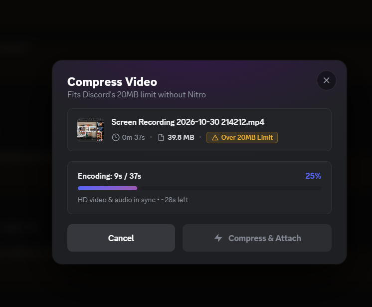
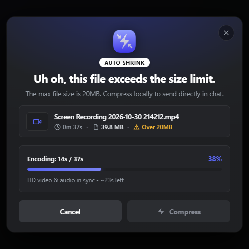

# ⚡ ShrinkCord

> **Automatically catch oversized videos and audio on Discord Web and shrink them under 20MB right in your browser.**  
> *100% Client-Side • Universal MP4 & WebM • Batch Processing • Open Source (GPLv3) • Zero Telemetry*

 

  
  &nbsp;&nbsp;
  

  <em>Left: Auto-detection with size, format &amp; resolution presets • Right: Live client-side transcoding with synchronized AV</em>

---

## 😤 The Problem
You record a gaming clip or audio track on your computer. You drag it into Discord, only to be slapped with the paywall:
> ❌ **"Uh oh, this file exceeds the size limit. The max file size is 20MB."**

## ⚡ The Solution
**ShrinkCord** silently intercepts media drop and paste events on `discord.com`:
1. **Catches oversized media instantly** before Discord triggers the Nitro paywall.
2. A 1:1 Discord Nitro-style modal allows shrinking to **19MB** with custom presets.
3. Compresses video and audio **locally in your browser** at hardware speeds.
4. **Automatically attaches** the compressed file back into your Discord message box ready to send!

---

## ✨ Features (100% Free & Open Source)
- **Universal MP4 Export:** Native H.264 MP4 export for seamless inline playback across iPhone/iOS, Android, Mac, and Windows.
- **Native Spoiler Tagging:** One-click "Mark as Spoiler" toggle automatically instructs Discord to wrap the clip in a spoiler blur layer (`SPOILER_` prefix).
- **Inline Clip Renaming:** Easily edit and rename your file right in the compression dialog before it gets attached.
- **Massive File Support:** Effortlessly handles 50MB to 500MB+ videos with adaptive bitrate scaling.
- **Batch / Queue Processing:** Drop multiple files at once — ShrinkCord queues and compresses them sequentially into your draft.
- **Target Size Presets:** Instant presets for 19 MB (Discord Free safe limit), 48 MB (Nitro Basic), or 8 MB (Compact).
- **Smart Clip Trimming:** One-click presets for 30s, 60s, or full video transcoding.
- **Audio Transcoding:** Downsamples voice and studio tracks to fit under Discord limits with clean 32kHz/22kHz WAV.

---

## 🔒 Privacy & Security First
* **Zero Cloud Servers:** Your videos **never leave your machine**. There is no backend server.
* **Zero Tracking / Telemetry:** No analytics, no Google Analytics, no tracking pixels.
* **Safe for Discord:** Does not use Discord user tokens, does not interact with Discord bots, and does not violate Discord Terms of Service. It simply feeds a valid, smaller file into the standard upload field.

---

## 🛠️ Quick Installation (30 Seconds)

Until ShrinkCord is available on the Chrome Web Store, you can install it in **Google Chrome**, **Brave**, **Microsoft Edge**, or any Chromium-based browser:

1. **Download the Extension:**
   * Download the latest **[`shrinkcord-v1.2.0.zip`](https://github.com/Isaac4096/shrink-cord/releases/latest)** from the [Releases page](https://github.com/Isaac4096/shrink-cord/releases).
2. **Extract the ZIP:**
   * Right-click the downloaded `.zip` file and select **Extract All...** to an accessible folder (e.g., `Documents/ShrinkCord`).
3. **Load into Browser:**
   * In your browser, open `chrome://extensions/` (or `brave://extensions/`, `edge://extensions/`).
   * Turn **ON** the **Developer mode** toggle in the top-right corner.
   * Click the **"Load unpacked"** button in the top-left corner.
   * Select the extracted folder containing `manifest.json`.
4. **Done!**
   * Open [Discord Web](https://discord.com/app), drag and drop any video or audio file larger than 20MB into chat, and let ShrinkCord squeeze it automatically!

---

## ⚙️ Configuration
Click the ShrinkCord icon in your browser toolbar to customize:
* **Default Video Format:** `MP4 (Universal)` (best for iPhone & Discord embeds) or `WebM`.
* **Default Target Size:** `19.0 MB` (Discord Free safe limit), `48.0 MB` (Nitro Basic), or `8.0 MB` (Compact).
* **Default Video Quality:** `1080p FHD` (crisp quality), `720p HD` (balanced), or `480p SD` (compact).

---

## ☕ Support the Project
If ShrinkCord saved you from buying Discord Nitro or made sharing clips easier, consider supporting continued development!

  
  &nbsp;&nbsp;
  

---

## 📄 License
This project is licensed under the **GNU General Public License v3.0 (GPLv3)** — see the [LICENSE](LICENSE) file for details.
